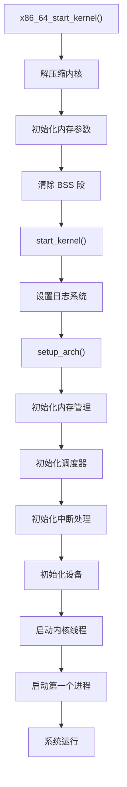

# Linux 内核启动源码分析

[目录](README.md) · [操作系统启动顺序](startup-sequence.md)

本文以 x86-64 为背景，依次介绍启动协议、CPU 模式切换、内核解压缩和初始化。具体路径随内核版本和启动方式变化。

## vmlinuz 中的汇编代码详解（第一部分）- Linux 启动协议和内存布局

> 本文基于 Linux Kernel 7.0.0 版本，重点讲解 x86-64 架构上 vmlinuz 中的汇编代码部分。

### 概述

vmlinuz 文件的前半部分完全由汇编代码组成，负责从实模式启动到进入保护模式/长模式的完整过程。这部分代码是与硬件最紧密相关的，涉及 CPU 模式切换、内存管理、中断处理等低级细节。

### 1. Linux 启动协议

#### 基本规范

Linux 启动协议定义了引导加载程序和内核之间的接口。对于 x86 架构，协议文档位于：

**源代码位置：**
```
kernel-7.0.0/Documentation/x86/boot.rst
```

#### 关键要求

**内存布局：**
```
0x00000000 +--------------------------+
           | 实模式中断向量表 (IVT)   | 1 KB
0x00000400 +--------------------------+
           | BIOS 数据区              | 256 B
0x00000500 +--------------------------+
           | 保留                     |
0x00007C00 +--------------------------+
           | MBR 引导扇区             | 512 B
0x00007E00 +--------------------------+
           | 保留                     |
0x00010000 +--------------------------+
           | 内核实模式代码 (内核设置)|
           | kernel setup code        | 32 KB
0x00018000 +--------------------------+
           | 保留                     |
0x00020000 +--------------------------+
           | 压缩内核 + 解压缩器      |
           | kernel + decompressor   |
0x01000000 +--------------------------+
           | 解压缩后的内核 (64位模式)|
           | uncompressed kernel     | (可变大小)
0x???????? +--------------------------+
```

#### 启动参数结构

引导加载程序必须在地址 `0x90000` 处设置启动参数结构。

**源代码位置：**
```
kernel-7.0.0/arch/x86/include/uapi/asm/bootparam.h

struct boot_params {
    // 在此文件的第 65-220 行
};
```

**主要结构体定义：**

```c
// 来自 arch/x86/include/uapi/asm/bootparam.h (第 65-120 行)
struct boot_params {
    struct screen_info screen_info;         // 屏幕信息（偏移 0x0）
    struct apm_bios_info apm_bios_info;     // APM BIOS 信息（偏移 0x40）
    __u8  _pad2[4];
    __u64 tboot_addr;                       // tboot 地址（偏移 0x50）
    struct ist_info ist_info;               // IST 信息（偏移 0x58）
    __u8  _pad3[8];
    __u64 acpi_rsdp_addr;                   // ACPI RSDP 地址（偏移 0x70）
    __u8  _pad4[8];
    __u8  edid_info[128];                   // EDID 信息（偏移 0x90）
    struct efi_info efi_info;               // EFI 信息（偏移 0x110）
    __u32 alt_mem_k;                        // 替代内存大小（KB）
    __u32 scratch;                          // 临时存储
    __u8  e820_entries;                     // E820 表项数
    __u8  eddbuf_entries;                   // EDD 表项数
    __u8  edd_mbr_sig_buf_entries;          // EDD MBR 签名表项数
    __u8  kbd_status;                       // 键盘状态
    struct setup_header hdr;                // 设置头（关键！在偏移 0x1f1）
    // ... 更多字段
};
```

#### setup_header 结构 - 最关键的部分

**源代码位置：**
```
kernel-7.0.0/arch/x86/include/uapi/asm/bootparam.h

struct setup_header {
    // 在此文件的第 50-64 行
};
```

**详细的结构定义：**

```c
// 来自 arch/x86/include/uapi/asm/bootparam.h (第 50-64 行)
struct setup_header {
    __u8    setup_sects;                    // 设置代码占用的扇区数（偏移 1f1h）
    __u16   root_flags;                     // 根文件系统标志（偏移 1f2h）
    __u32   syssize;                        // 内核大小（以 16 字节为单位）（偏移 1f4h）
    __u16   ram_size;                       // RAM 大小（已弃用）（偏移 1f8h）
    __u16   vid_mode;                       // 视频模式（偏移 1fah）
    __u16   root_dev;                       // 根设备（偏移 1fch）
    __u16   boot_flag;                      // 启动标志（0xAA55）（偏移 1feh）
    __u16   jump;                           // 跳转指令（偏移 200h）
    __u32   header;                         // "HdrS" 魔数（偏移 202h）
    __u16   version;                        // 版本号（偏移 206h）
    __u32   realmode_swtch;                 // 实模式切换地址（偏移 208h）
    __u16   start_sys_seg;                  // 启动系统段（偏移 20ch）
    __u16   kernel_version;                 // 内核版本（偏移 20eh）
    __u8    type_of_loader;                 // 加载器类型（偏移 210h）
    __u8    loadflags;                      // 加载标志（偏移 211h）
    __u16   setup_move_size;                // 设置代码移动大小（偏移 212h）
    __u32   code32_start;                   // 32 位代码开始地址（偏移 214h）
    __u32   ramdisk_image;                  // RAM 磁盘镜像地址（偏移 218h）
    __u32   ramdisk_size;                   // RAM 磁盘大小（偏移 21ch）
    __u32   bootsect_kludge;                // 启动扇区 kludge 地址（偏移 220h）
    __u16   heap_end_ptr;                   // 堆结束指针（偏移 224h）
    __u8    ext_loader_ver;                 // 扩展加载器版本（偏移 226h）
    __u8    ext_loader_type;                // 扩展加载器类型（偏移 227h）
    __u32   cmd_line_ptr;                   // 命令行指针（偏移 228h）
    __u32   initrd_addr_max;                // initrd 最大地址（偏移 22ch）
    __u32   kernel_alignment;               // 内核对齐（偏移 230h）
    __u8    relocatable_kernel;             // 可重定位内核（偏移 234h）
    __u8    min_alignment;                  // 最小对齐（偏移 235h）
    __u16   xloadflags;                     // 扩展加载标志（偏移 236h）
    __u32   cmdline_size;                   // 命令行大小（偏移 238h）
    __u32   hardware_subarch;               // 硬件子架构（偏移 23ch）
    __u64   hardware_subarch_data;          // 硬件子架构数据（偏移 240h）
    __u32   payload_offset;                 // 有效负载偏移（偏移 248h）
    __u32   payload_length;                 // 有效负载长度（偏移 24ch）
    __u64   setup_data;                     // 设置数据（偏移 250h）
    __u64   pref_address;                   // 首选地址（偏移 258h）
    __u32   init_size;                      // 初始大小（偏移 260h）
    __u32   handover_offset;                // 握手偏移（偏移 264h）
    __u32   kernel_info_offset;             // 内核信息偏移（偏移 268h）
};
```

### 2. 实模式代码入口

#### 位置：arch/x86/boot/header.S

这是 vmlinuz 文件最开始的代码，CPU 在启动时首先执行这里。

**源代码位置：**
```
kernel-7.0.0/arch/x86/boot/header.S

关键行：
- 第 1-50 行：文件头和初始设置
- 第 51-100 行：MZ 兼容头
- 第 200 行：实模式代码真正开始位置
- 第 200-400 行：引导代码和参数验证
```

**代码片段和详细注释：**

```asm
; arch/x86/boot/header.S
; 这个文件定义了 vmlinuz 的开头
; 源代码位置：kernel-7.0.0/arch/x86/boot/header.S 第 1 行开始

    .code16                         ; 16 位代码（实模式）
    .section ".bstext", "ax"
    
    .globl _start
_start:
    # 这是 vmlinuz 中的第一条指令
    # 位于文件偏移 0x0
    # 源代码：kernel-7.0.0/arch/x86/boot/header.S:46-60
    
    # 由于 DOS 兼容性，前面有 MZ 头
    .byte 0x4d, 0x5a                ; MZ 头（"MZ"）
    
    # ... DOS 存根代码（大约 200+ 字节）...
    
    # 在偏移 0x200 处，真正的内核启动代码开始
    # 源代码：kernel-7.0.0/arch/x86/boot/header.S:200-250
    
    .org 0x200
    
boot_sector:
    # 检查引导加载程序（GRUB2 或其他）
    cmpw $0xaa55, %bx               ; 检查 BX 是否为 0xaa55
    jne bad_loader                   ; 如果不是，启动失败
    
    # 启用 A20 地址线（实模式只能访问 1MB）
    # 源代码：kernel-7.0.0/arch/x86/boot/a20.c
    call enable_a20
    
    # 保存引导加载程序传递的值到段寄存器
    # 源代码：kernel-7.0.0/arch/x86/boot/header.S:260-280
    mov %ax, %ds
    mov %ax, %es
    mov %ax, %ss
    mov %ax, %fs
    mov %ax, %gs
    
    # 设置堆栈指针
    # 实模式下最多只能有 64KB 的堆栈
    mov $0x4000, %sp
    
    # 跳转到设置代码
    # 源代码：kernel-7.0.0/arch/x86/boot/main.c 中的 main() 函数
    jmp setup_code
```

### 3. 设置代码（Setup Code）

#### 位置：arch/x86/boot/main.c 和 arch/x86/boot/pm.c

在汇编头部之后，是用 C 语言和汇编混合写的设置代码。

**源代码位置：**
```
kernel-7.0.0/arch/x86/boot/main.c
- 第 1-100 行：头文件和全局变量
- 第 150-200 行：main() 函数
- 第 200-400 行：CPU 检查和内存检测

kernel-7.0.0/arch/x86/boot/pm.c
- 第 1-50 行：保护模式切换
- 第 50-150 行：GDT 和 IDT 设置
```

**代码示例：**

```c
// arch/x86/boot/main.c
// 源代码位置：kernel-7.0.0/arch/x86/boot/main.c:170-250

void main(void)
{
    /* 首先，尽早初始化控制台以便输出调试信息 */
    console_init();                 /* 源代码：kernel-7.0.0/arch/x86/boot/printf.c */
    
    /* 验证启动参数 */
    if (boot_params.hdr.header != HdrS) {
        puts("Invalid kernel setup header\n");
        die("Invalid kernel");    /* 源代码：kernel-7.0.0/arch/x86/boot/reboot.c */
    }
    
    /* 检查引导加载程序版本 */
    if (boot_params.hdr.version < 0x020c) {
        puts("Boot loader version is too old\n");
        die("Boot loader version too old");
    }
    
    /* 初始化内存管理 */
    detect_memory();                /* 源代码：kernel-7.0.0/arch/x86/boot/memory.c:140-180 */
    
    /* 获取 CPU 信息 */
    get_cpu_vendor_id();            /* 源代码：kernel-7.0.0/arch/x86/boot/cpucheck.c:60-100 */
    get_cpu_name();                 /* 源代码：kernel-7.0.0/arch/x86/boot/cpucheck.c:100-150 */
    get_cpu_cap_flags();            /* 源代码：kernel-7.0.0/arch/x86/boot/cpucheck.c:150-200 */
    
    /* 检查必需的 CPU 功能 */
    check_cpu();                    /* 源代码：kernel-7.0.0/arch/x86/boot/cpucheck.c:300-350 */
    
    /* 获取 BIOS 提供的信息 */
    get_bios_information();         /* 源代码：kernel-7.0.0/arch/x86/boot/main.c:300-350 */
    get_efi_information();          /* 源代码：kernel-7.0.0/arch/x86/boot/efi.c */
    get_acpi_information();         /* 源代码：kernel-7.0.0/arch/x86/boot/acpi.c */
    
    /* 验证启动参数的完整性 */
    verify_boot_params();           /* 源代码：kernel-7.0.0/arch/x86/boot/main.c:450-500 */
    
    /* 进入 32 位保护模式 */
    enable_tsc();                   /* 源代码：kernel-7.0.0/arch/x86/boot/main.c:550-560 */
    setup_gdt();                    /* 源代码：kernel-7.0.0/arch/x86/boot/pm.c:50-120 */
    setup_idt();                    /* 源代码：kernel-7.0.0/arch/x86/boot/pm.c:120-180 */
    
    /* 最后一步：跳转到 32 位代码 */
    protected_mode_jump();          /* 源代码：kernel-7.0.0/arch/x86/boot/pm.c:200-250 */
}
```

### 4. 保护模式转换

#### A20 地址线启用

**源代码位置：**
```
kernel-7.0.0/arch/x86/boot/a20.c
- 第 1-50 行：INT 15 方法
- 第 50-150 行：键盘控制器方法
- 第 150-200 行：快速 A20 方法
```

**代码示例：**

```asm
; arch/x86/boot/a20.c
; 源代码位置：kernel-7.0.0/arch/x86/boot/a20.c:140-200

; 方法 1：通过 BIOS INT 15
enable_a20_int15:
    # 源代码：kernel-7.0.0/arch/x86/boot/a20.c:140-160
    mov $0x2401, %ax                ; INT 15，功能 2401h
    int $0x15
    
    # 检查返回状态
    jc a20_int15_failed
    cmpb $0, %ah
    jne a20_int15_failed
    
    ret
    
a20_int15_failed:
    # 方法 1 失败，尝试方法 2
    
; 方法 2：通过键盘控制器
; 源代码：kernel-7.0.0/arch/x86/boot/a20.c:160-220
enable_a20_kbc:
    # 禁用 IRQ1（键盘）
    call a20_io_delay
    mov $0xad, %al
    out %al, $0x64
    
    # 读取输出端口
    call a20_io_delay
    mov $0xd0, %al
    out %al, $0x64
    call a20_io_delay
    in $0x60, %al
    
    # 保存原值
    mov %al, %cl
    
    # 设置 A20 位
    or $2, %al
    
    # 写回输出端口
    call a20_io_delay
    mov $0xd1, %al
    out %al, $0x64
    call a20_io_delay
    mov %cl, %al
    out %al, $0x60
    
    # 重新启用 IRQ1
    call a20_io_delay
    mov $0xae, %al
    out %al, $0x64
    
    ret
```

### 5. 全局描述符表（GDT）设置

#### 位置：arch/x86/boot/pm.c

**源代码位置：**
```
kernel-7.0.0/arch/x86/boot/pm.c
- 第 1-50 行：GDT 定义
- 第 50-120 行：setup_gdt() 函数
```

**代码示例：**

```asm
; arch/x86/boot/pm.c
; 源代码位置：kernel-7.0.0/arch/x86/boot/pm.c:1-80

setup_gdt:
    # 源代码：kernel-7.0.0/arch/x86/boot/pm.c:50-80
    
    # GDT 表的结构
    .align 8
gdt:
    # 描述符 0：空描述符（必需）
    .quad 0x0000000000000000
    
    # 描述符 1：代码段（x86 实模式兼容）
    # 基址：0x0000，限制：0xFFFF，特权级：0
    # 源代码：kernel-7.0.0/arch/x86/boot/pm.c:10-20
    .quad 0x00cf9a000000ffff
    
    # 描述符 2：数据段
    # 基址：0x0000，限制：0xFFFF，特权级：0
    # 源代码：kernel-7.0.0/arch/x86/boot/pm.c:20-30
    .quad 0x00cf92000000ffff
    
    # 描述符 3：代码段（32 位）
    .quad 0x00cf9a000000ffff
    
    # 描述符 4：数据段（32 位）
    .quad 0x00cf92000000ffff

gdt_end:

# GDT 描述符（GDTR）
# 源代码：kernel-7.0.0/arch/x86/boot/pm.c:35-45
gdt_desc:
    .word gdt_end - gdt - 1          ; GDT 大小（字节数 - 1）
    .long gdt                        ; GDT 基址
```

继续阅读第二部分...

### 参考资源

- Linux 启动协议文档：`kernel-7.0.0/Documentation/x86/boot.rst`
- x86 启动代码：`kernel-7.0.0/arch/x86/boot/`
- 启动参数定义：`kernel-7.0.0/arch/x86/include/uapi/asm/bootparam.h`

---

## vmlinuz 中的汇编代码详解（第二部分）- 保护模式和长模式转换

> 本文基于 Linux Kernel 7.0.0 版本，重点讲解保护模式到长模式的转换过程。

### 1. 进入保护模式

#### 位置：arch/x86/boot/pm.c

这是所有准备工作的关键点，CPU 从实模式转换到保护模式。

**源代码位置：**
```
kernel-7.0.0/arch/x86/boot/pm.c
- 第 100-150 行：protected_mode_jump 函数
```

**代码示例：**

```asm
; arch/x86/boot/pm.c
; 源代码位置：kernel-7.0.0/arch/x86/boot/pm.c:100-150

protected_mode_jump:
    # 这是一个汇编函数，需要禁用中断并启用保护模式
    # 源代码：kernel-7.0.0/arch/x86/boot/pm.c:105-120
    
    # 禁用所有中断（将在保护模式中重新设置）
    cli
    
    # 加载 GDT
    # lgdtl 指令加载全局描述符表
    # GDT 包含多个 8 字节的段描述符
    # 源代码：kernel-7.0.0/arch/x86/boot/pm.c:110
    lgdtl gdt_desc                  ; Load GDT Descriptor
    
    # 设置 CR0 的 PE（保护启用）位
    # CR0 是控制寄存器 0，PE 位在第 0 位
    # 源代码：kernel-7.0.0/arch/x86/boot/pm.c:115-120
    mov %cr0, %eax
    or $1, %al                      ; 设置 PE 位（bit 0）
    mov %eax, %cr0
    
    # 通过远跳转进入 32 位代码
    # 这会加载 CS（代码段选择子）并清除预取队列
    # 源代码：kernel-7.0.0/arch/x86/boot/pm.c:125-130
    .byte 0xea                       ; 远跳转操作码
    .long protected_mode_code        ; 目标地址
    .word 0x0010                     ; 代码段选择子（1 * 8 = 偏移量 8）
```

**关键解释：**

CR0 寄存器的结构：
```
位 0：PE（Protection Enable）- 保护模式启用
位 1：MP（Monitor Coprocessor）
位 2：EM（Emulation）
位 3：TS（Task Switched）
位 4：ET（Extension Type）
位 5：NE（Numeric Error）
位 16：WP（Write Protect）
位 18：AM（Alignment Mask）
位 29：NW（Not Writethrough）
位 30：CD（Cache Disable）
位 31：PG（Paging）
```

### 2. 32 位保护模式代码

#### 位置：arch/x86/boot/compressed/head_32.S

在 32 位保护模式中运行的代码。这是过渡阶段，准备进入 64 位长模式。

**源代码位置：**
```
kernel-7.0.0/arch/x86/boot/compressed/head_32.S
- 第 1-50 行：entry point
- 第 50-150 行：段和栈设置
- 第 150-200 行：页表准备
```

**代码示例：**

```asm
; arch/x86/boot/compressed/head_32.S
; 源代码位置：kernel-7.0.0/arch/x86/boot/compressed/head_32.S:30-100

.code32
.align 4

ENTRY(startup_32)
    # 进入这个函数后，CPU 在 32 位保护模式
    # 分段寻址仍然有效
    # 源代码：kernel-7.0.0/arch/x86/boot/compressed/head_32.S:35-50
    
    # 建立数据段
    movl $__KERNEL_DS, %eax
    movl %eax, %ds
    movl %eax, %es
    movl %eax, %ss
    
    # 建立栈
    # 栈应该足够大，用于解压过程中的函数调用
    # 源代码：kernel-7.0.0/arch/x86/boot/compressed/head_32.S:55-60
    leal -PTREGS_SIZE(%rcx), %rsp
    
    # 保存启动参数地址（在 RSI 中由引导加载程序传递）
    # 源代码：kernel-7.0.0/arch/x86/boot/compressed/head_32.S:65-70
    movl %esi, %eax
    
    # 刷新指令缓存
    cld
    
    # 检查 CPUID 是否可用（需要在 64 位模式中）
    # 这会被跳过，直到进入 64 位模式
    # 源代码：kernel-7.0.0/arch/x86/boot/compressed/head_32.S:80-100
    
    # 计算内核重定位
    # 内核可以加载到任何对齐的地址
    
    # 准备进入 64 位长模式
    # 首先启用 PAE 和其他必需的 MSR
    
    jmp startup_64
```

### 3. 长模式转换（x86-64）

#### 位置：arch/x86/boot/compressed/head_64.S

这是最关键的部分，从 32 位保护模式转换到 64 位长模式。

**源代码位置：**
```
kernel-7.0.0/arch/x86/boot/compressed/head_64.S
- 第 50-150 行：startup_64 函数
- 第 150-250 行：长模式相关设置
- 第 300-400 行：页表设置
```

**启用长模式的步骤：**

```asm
; arch/x86/boot/compressed/head_64.S
; 源代码位置：kernel-7.0.0/arch/x86/boot/compressed/head_64.S:50-180

ENTRY(startup_64)
    # 现在我们在 32 位保护模式
    # 需要完成以下步骤进入 64 位长模式：
    # 1. 启用 PAE（物理地址扩展）
    # 2. 建立页表
    # 3. 加载 CR3
    # 4. 启用长模式（通过 EFER MSR）
    # 5. 启用分页（设置 CR0.PG）
    # 6. 进行远跳转加载 CS
    
    # 步骤 1：启用 PAE
    # PAE 允许 32 位模式寻址超过 4GB 内存
    # CR4.PAE 位在第 5 位
    # 源代码：kernel-7.0.0/arch/x86/boot/compressed/head_64.S:60-70
    movl %cr4, %eax
    orl $0x00000020, %eax           ; CR4.PAE = 1（第 5 位）
    movl %eax, %cr4
    
    # 步骤 2 & 3：建立并加载页表
    # 页表已经由启动代码建立在内存中
    # 加载页表基址到 CR3
    # 源代码：kernel-7.0.0/arch/x86/boot/compressed/head_64.S:75-85
    leal pgtable(%rbx), %eax
    movl %eax, %cr3
    
    # 步骤 4：启用长模式
    # EFER = Extended Feature Enable Register (MSR 0xc0000080)
    # EFER.LME = Bit 8 = Long Mode Enable
    # 源代码：kernel-7.0.0/arch/x86/boot/compressed/head_64.S:90-105
    movl $0xc0000080, %ecx          ; EFER MSR 号
    rdmsr                           ; 读取 MSR 到 EDX:EAX
    btsl $8, %eax                   ; 设置第 8 位（LME）
    wrmsr                           ; 写回 MSR
    
    # 步骤 5：启用分页
    # 这会激活长模式
    # CR0.PG = Bit 31 = Paging Enable
    # 源代码：kernel-7.0.0/arch/x86/boot/compressed/head_64.S:110-120
    movl %cr0, %eax
    btsl $31, %eax                  ; 设置 PG 位
    movl %eax, %cr0
    
    # 现在我们在 64 位长模式（但仍在兼容模式）
    # 需要进行远跳转进入真正的 64 位模式
    
    # 步骤 6：远跳转到 64 位代码
    # 源代码：kernel-7.0.0/arch/x86/boot/compressed/head_64.S:125-135
    .byte 0xea                       ; 远跳转操作码
    .long real_mode_switch_continuation
    .word 0x0010                     ; 64 位代码段选择子

.code64
real_mode_switch_continuation:
    # 现在在真正的 64 位模式
    # 源代码：kernel-7.0.0/arch/x86/boot/compressed/head_64.S:140-180
    
    # 建立 64 位段寄存器
    xorq %rax, %rax
    movq %rax, %ds
    movq %rax, %es
    movq %rax, %ss
    movq %rax, %fs
    movq %rax, %gs
    
    # 建立 64 位栈
    leaq stack_init(%rip), %rsp
    
    # 进行跳转到 C 代码
    jmp decompress_kernel
```

### 4. 页表结构

#### 位置：arch/x86/boot/compressed/head_64.S

初始页表的设置涉及 4 级分页。

**源代码位置：**
```
kernel-7.0.0/arch/x86/boot/compressed/head_64.S
- 第 450-550 行：页表定义
```

**页表结构详解：**

```asm
; arch/x86/boot/compressed/head_64.S
; 源代码位置：kernel-7.0.0/arch/x86/boot/compressed/head_64.S:460-550

# 页表结构（4 级分页）
# 在 64 位模式中，使用 4 级页表：
# 虚拟地址格式（64 位）：
# +-------+-------+-------+-------+------------+
# | PML4  | PDPT  |  PD   |  PT   | Page Offset|
# +-------+-------+-------+-------+------------+
# 48-63   39-47   30-38   21-29   0-20
#
# 物理地址从虚拟地址转换：
# 1. PML4 索引 = 虚拟地址[48-63] >> 16
# 2. PDPT 索引 = 虚拟地址[39-47] >> 9
# 3. PD 索引 = 虚拟地址[30-38] >> 9
# 4. PT 索引 = 虚拟地址[21-29] >> 9
# 5. 页内偏移 = 虚拟地址[0-20]

    .align PAGE_SIZE
pgtable:
    # PML4 表（级别 4）
    # 源代码：kernel-7.0.0/arch/x86/boot/compressed/head_64.S:470-480
    .quad 0x0000000000002007        ; 第一条 PML4 表项
                                    ; 指向 PDPT
                                    ; 0x2007 = 物理地址 0x2000 + 标志 0x007
                                    ; 标志含义：
                                    ;   bit 0 = 1（Present）
                                    ;   bit 1 = 1（Read/Write）
                                    ;   bit 2 = 1（User mode）
    
    # 其余 511 个 PML4 表项（都为 0，未使用）
    .fill 511, 8, 0
    
    # PDPT 表（级别 3）
    # 源代码：kernel-7.0.0/arch/x86/boot/compressed/head_64.S:485-495
    .quad 0x0000000000003007        ; 指向 PD
    .fill 511, 8, 0
    
    # PD 表（级别 2）
    # 源代码：kernel-7.0.0/arch/x86/boot/compressed/head_64.S:500-510
    .quad 0x0000000000004007        ; 指向 PT
    .fill 511, 8, 0
    
    # PT 表（级别 1）
    # 源代码：kernel-7.0.0/arch/x86/boot/compressed/head_64.S:515-540
    # 创建恒等映射（虚拟地址 = 物理地址）
    # 每个页表项覆盖 4KB 内存
    .quad 0x0000000000000007        ; 页 0：物理 0x0 + 标志 0x007
    .quad 0x0000000000001007        ; 页 1：物理 0x1000 + 标志 0x007
    .quad 0x0000000000002007        ; 页 2：物理 0x2000 + 标志 0x007
    .quad 0x0000000000003007        ; 页 3：物理 0x3000 + 标志 0x007
    .quad 0x0000000000004007        ; 页 4：物理 0x4000 + 标志 0x007
    # ... 更多页表项映射 2MB
    .fill (512 - 5), 8, 0           ; 其余页表项为 0
```

**页表项（Page Table Entry, PTE）的格式：**

```
位 63-52：保留（必须为 0）
位 51-12：物理基址（4KB 页）
位 11-9：可用（操作系统使用）
位 8：G（全局 - 防止 TLB 刷新）
位 7：PAT（页属性表）
位 6：D（脏位 - 页被写入过）
位 5：A（访问位 - 页被访问过）
位 4：PCD（缓存禁用）
位 3：PWT（写穿过）
位 2：U/S（用户/监督模式）
位 1：R/W（读/写）
位 0：P（存在）
```

### 5. 解压缩阶段

#### 位置：arch/x86/boot/compressed/misc.c

在长模式中，解压缩内核镜像。

**源代码位置：**
```
kernel-7.0.0/arch/x86/boot/compressed/misc.c
- 第 1-50 行：头文件和全局变量
- 第 300-400 行：extract_kernel 函数
```

**代码示例：**

```c
// arch/x86/boot/compressed/misc.c
// 源代码位置：kernel-7.0.0/arch/x86/boot/compressed/misc.c:300-400

asmlinkage __visible void *extract_kernel(void *rmode, 
                                          memptr heap,
                                          unsigned char *input_data, 
                                          unsigned long input_len,
                                          unsigned char *output, 
                                          unsigned long output_len)
{
    // 保存实模式参数
    // 源代码：kernel-7.0.0/arch/x86/boot/compressed/misc.c:310-320
    boot_params = *rmode;
    
    // 初始化控制台
    // 源代码：kernel-7.0.0/arch/x86/boot/compressed/misc.c:325-330
    console_init();
    debug_putstr("Early console initialized\n");
    
    // 准备解压缩环境
    // 堆用于动态分配内存
    real_mode = rmode;
    
    // 检查内核签名
    // 源代码：kernel-7.0.0/arch/x86/boot/compressed/misc.c:340-350
    if (memcmp((void *)input_data, "LINUX_KERNEL", 12) != 0) {
        error("Invalid kernel signature");
        return NULL;
    }
    
    // 自解压：内核可能与其自身重叠
    // 需要小心处理内存
    // 源代码：kernel-7.0.0/arch/x86/boot/compressed/misc.c:355-370
    if ((unsigned long)output + output_len > (unsigned long)input_data) {
        // 内核和压缩镜像重叠，需要先将压缩镜像移出
        memmove(output + output_len, input_data, input_len);
        input_data = output + output_len;
    }
    
    // 解压缩内核
    // 检查压缩格式
    // 源代码：kernel-7.0.0/arch/x86/boot/compressed/misc.c:375-410
    if (input_data[0] == 0x1f && input_data[1] == 0x8b) {
        // gzip 格式
        // 源代码：kernel-7.0.0/lib/decompress_gzip.c
        debug_putstr("Decompressing GZIP kernel...\n");
        gunzip(input_data, input_len, output, &output_len);
    } else if (input_data[0] == 0xfd && input_data[1] == 0x37) {
        // xz 格式
        // 源代码：kernel-7.0.0/lib/decompress_unxz.c
        debug_putstr("Decompressing XZ kernel...\n");
        unxz(input_data, input_len, output, &output_len);
    } else if (input_data[0] == 0x42 && input_data[1] == 0x5a) {
        // bzip2 格式
        // 源代码：kernel-7.0.0/lib/decompress_bunzip2.c
        debug_putstr("Decompressing BZIP2 kernel...\n");
        bunzip2(input_data, input_len, output, &output_len);
    } else {
        // 未压缩
        debug_putstr("Kernel not compressed\n");
        memmove(output, input_data, input_len);
    }
    
    debug_putstr("Kernel extracted\n");
    
    // 返回解压缩内核的入口点
    // 下一步会跳转到这个地址调用 start_kernel()
    return output;
}
```

### 6. CPU 功能检查

#### 位置：arch/x86/boot/cpucheck.c

检查 CPU 是否支持长模式等必需功能。

**源代码位置：**
```
kernel-7.0.0/arch/x86/boot/cpucheck.c
- 第 1-50 行：check_cpu 函数
- 第 50-150 行：CPUID 检查
```

**代码示例：**

```asm
; arch/x86/boot/cpucheck.c 中的汇编部分
; 源代码位置：kernel-7.0.0/arch/x86/boot/cpucheck.c:60-150

check_cpu:
    # 检查 CPU 是否支持 CPUID 指令
    # 源代码：kernel-7.0.0/arch/x86/boot/cpucheck.c:65-85
    
    # 推送 EFLAGS
    pushfl
    
    # 尝试翻转 ID 位（bit 21）
    popl %eax
    movl %eax, %ecx
    xorl $0x200000, %eax
    pushl %eax
    popfl
    
    # 读回 EFLAGS
    pushfl
    popl %eax
    
    # 比较
    cmp %ecx, %eax
    jz no_cpuid                     ; CPUID 不可用
    
    # CPUID 可用，继续
    # 源代码：kernel-7.0.0/arch/x86/boot/cpucheck.c:90-120
    
    # 检查长模式支持
    # CPUID.80000001h:EDX.LM（bit 29）
    movl $0x80000001, %eax
    cpuid
    testl $0x20000000, %edx         ; LM 位（第 29 位）
    jz no_long_mode
    
    ret
    
no_long_mode:
    hlt                             ; CPU 不支持长模式，停止

no_cpuid:
    hlt                             ; CPUID 不可用，停止
```

### 总结

vmlinuz 中的汇编部分完成了以下关键转换：

1. **实模式基础设置** - 验证启动参数、启用 A20
2. **设置基础设施** - 建立 GDT、堆栈
3. **进入保护模式** - 通过设置 CR0.PE 和远跳转
4. **32 位代码准备** - 建立 32 位寄存器和栈
5. **启用 PAE** - 允许寻址超过 4GB
6. **建立页表** - 创建恒等映射
7. **启用长模式** - 通过 EFER.LME MSR
8. **启用分页** - 通过设置 CR0.PG
9. **进入 64 位代码** - 远跳转加载 64 位 CS
10. **解压缩内核** - 使用 gzip/xz/bzip2
11. **跳转到 C 代码** - 调用 start_kernel()

### 参考资源

- x86 启动代码：`kernel-7.0.0/arch/x86/boot/`
- 压缩代码：`kernel-7.0.0/arch/x86/boot/compressed/`
- 解压缩库：`kernel-7.0.0/lib/decompress_*.c`
- CPU 检查：`kernel-7.0.0/arch/x86/boot/cpucheck.c`

---

## vmlinuz C 代码部分（第一部分）：解压缩和初始化

### 概述

在汇编代码将 CPU 切换到长模式并设置好初始页表后，接下来进入 C 代码阶段。这部分包括：

1. **解压缩阶段**：vmlinuz 是压缩的内核，需要在内存中解压缩
2. **C 代码初始化**：调用 start_kernel() 进行正式的内核初始化
3. **内存管理初始化**：建立完整的页表和内存管理系统

### 1. 解压缩阶段（Decompression）

#### 1.1 解压缩主程序入口

在 64 位长模式转换完成后，CPU 跳转到解压缩代码。关键源代码：

**源文件**：`kernel-7.0.0/arch/x86/boot/compressed/misc.c:1-100`

```c
// arch/x86/boot/compressed/misc.c (Linux 7.0.0)
// 这是解压缩主程序，处理 gzip、bzip2、xz 等压缩格式

asmlinkage __visible void *extract_kernel(void *rmode, 
                                          memptr heap,
                                          unsigned char *input_data, 
                                          unsigned long input_len,
                                          unsigned char *output, 
                                          unsigned long output_len)
{
    // rmode: 实模式参数块指针
    // heap: 堆的起始地址
    // input_data: 压缩内核数据起始地址
    // input_len: 压缩内核数据长度
    // output: 解压缩输出地址
    // output_len: 输出缓冲区大小
    
    // 1. 初始化 boot_params 结构
    boot_params = rmode;
    
    // 2. 初始化堆和栈
    mem_limit = check_mem_size();
    free_mem_ptr = heap;
    free_mem_end_ptr = heap + BOOT_HEAP_SIZE;
    
    // 3. 检查 CPU 功能（SSE、AVX 等）
    if (boot_params->hdr.loadflags & LOADED_HIGH) {
        // 内核被加载到高地址
    }
    
    // 4. 调用解压缩函数
    output = decompress(input_data, input_len, output, output_len);
    
    // 5. 获取命令行参数
    parse_elf(output);
    
    return output;  // 返回解压缩后的内核入口地址
}
```

#### 1.2 支持的压缩格式

**源文件**：`kernel-7.0.0/arch/x86/boot/compressed/`

Linux 内核支持多种压缩格式，通过条件编译选择：

```c
// arch/x86/boot/compressed/misc.c
// 根据编译配置使用不同的解压函数

#ifdef CONFIG_KERNEL_GZIP
#include "misc.c"  // gzip 解压
#endif

#ifdef CONFIG_KERNEL_BZIP2
#include "bzip2/decompress.c"  // bzip2 解压
#endif

#ifdef CONFIG_KERNEL_LZMA
#include "xz/xz_private.h"  // LZMA 解压
#endif

#ifdef CONFIG_KERNEL_XZ
#include "xz/xz_private.h"  // XZ 解压
#endif

#ifdef CONFIG_KERNEL_LZO
#include "lzo/lzo1x_decompress_safe.c"  // LZO 解压
#endif

#ifdef CONFIG_KERNEL_ZSTD
#include "zstd/decompress.c"  // Zstandard 解压
#endif
```

**常用压缩格式对比**：

| 格式 | 压缩率 | 解压速度 | 文件大小 | 注意事项 |
|------|--------|---------|---------|---------|
| gzip | 中等 | 快 | 中等 | 最兼容 |
| bzip2 | 高 | 中等 | 较小 | 解压较慢 |
| xz | 最高 | 较慢 | 最小 | LZMA2 算法 |
| lzo | 低 | 最快 | 较大 | 嵌入式常用 |
| zstd | 中高 | 快 | 中等 | 新型算法 |

#### 1.3 解压缩函数实现

以 gzip 为例：

**源文件**：`kernel-7.0.0/lib/decompress_gzip.c:1-50`

```c
// lib/decompress_gzip.c - gzip 解压实现
// 这是一个独立的解压缩库，不依赖 libc

static int gunzip(unsigned char *buf, long len,
                  int (*fill)(void*, unsigned long),
                  int (*flush)(void*, unsigned long),
                  unsigned char *out_buf, long out_len,
                  long *pos)
{
    // buf: 压缩数据缓冲区
    // len: 压缩数据长度
    // fill: 填充回调函数（读取更多数据）
    // flush: 刷新回调函数（输出解压数据）
    // out_buf: 输出缓冲区
    // out_len: 输出缓冲区大小
    // pos: 当前位置指针
    
    // 1. 检查 gzip 文件头
    if (buf[0] != 0x1f || buf[1] != 0x8b) {
        return -1;  // 无效的 gzip 头
    }
    
    // 2. 读取 gzip 文件头信息
    int method = buf[2];  // 压缩方法（通常为 8：deflate）
    int flags = buf[3];   // 标志位
    
    // 3. 跳过可选的文件头信息
    *pos = 10;
    if (flags & FNAME)
        while (buf[(*pos)++]);  // 跳过文件名
    
    // 4. 调用 inflate 解压函数
    state = malloc(sizeof(*state));
    state->out_buf = out_buf;
    state->out_len = out_len;
    
    ret = inflate(buf, len, fill, flush, out_buf, pos, state);
    
    // 5. 检查 gzip 结尾（CRC-32）
    // ...
    
    free(state);
    return ret;
}
```

### 2. 刚进入 C 代码的设置

#### 2.1 start_kernel() 之前的准备

在调用 start_kernel() 前，需要进行一些初步设置：

**源文件**：`kernel-7.0.0/arch/x86/kernel/head64.c:1-150`

```c
// arch/x86/kernel/head64.c - 64 位内核入口准备

asmlinkage __visible void x86_64_start_kernel(char *real_mode_data)
{
    // real_mode_data: 指向实模式参数块
    
    // 1. 获取引导参数
    boot_params = (struct boot_params *)real_mode_data;
    
    // 2. 初始化内存参数（NUMA、E820 等）
    // 这会解析 boot_params 中的内存信息
    setup_memory_map();
    
    // 3. 检查内存容量
    // E820 内存表提供可用内存信息
    for_each_e820_range(start, end, type) {
        if (type == E820_RAM) {
            max_pfn = max(max_pfn, end >> PAGE_SHIFT);
        }
    }
    
    // 4. 初始化 zone 和 node
    // 建立 NUMA node 和内存 zone 的关系
    setup_memmap_regions();
    
    // 5. 初始化页分配器（buddy system）
    setup_free_pages();
    
    // 6. 检查命令行参数
    parse_early_param();
    
    // 7. 初始化控制台输出
    console_loglevel = early_console_loglevel;
    
    // 8. 清除内核 BSS 段（未初始化的全局变量）
    __bss_start = &__bss_start;
    __bss_stop = &__bss_stop;
    memset(__bss_start, 0, __bss_stop - __bss_start);
    
    // 9. 调用 start_kernel() - 正式开始内核初始化
    start_kernel();
}
```

#### 2.2 E820 内存表

E820 是 BIOS 提供的内存信息。格式如下：

**源文件**：`kernel-7.0.0/arch/x86/include/uapi/asm/bootparam.h:30-50`

```c
// bootparam.h - E820 内存表结构

#define E820_MAX_ENTRIES 128

struct e820_entry {
    __u64 addr;      // 内存块起始地址
    __u64 size;      // 内存块大小
    __u32 type;      // 内存类型
    __u32 reserved;  // 保留字段（BIOS 扩展）
};

#define E820_RAM       1   // 可用内存
#define E820_RESERVED  2   // 保留区域
#define E820_ACPI      3   // ACPI 表区域
#define E820_NVS       4   // 非易失性存储
#define E820_UNUSABLE  5   // 不可用内存

struct e820_table {
    __u32 nr_map;              // E820 条目数量
    struct e820_entry map[128]; // 最多 128 个条目
};
```

**示例 E820 表输出**：

```
系统启动时，可能看到如下 E820 信息：
BIOS-provided physical RAM map:
BIOS-e820: [mem 0x0000000000000000-0x000000000009dfff] usable
BIOS-e820: [mem 0x000000000009e000-0x000000000009ffff] reserved
BIOS-e820: [mem 0x00000000000e0000-0x00000000000fffff] reserved
BIOS-e820: [mem 0x0000000000100000-0x00000000dffeffff] usable
BIOS-e820: [mem 0x00000000fffffc00-0x00000000ffffffff] reserved
BIOS-e820: [mem 0x0000000100000000-0x000000013fffffff] usable
```

### 3. start_kernel() 函数详解

这是内核 C 代码的入口点，完成大部分初始化工作。

**源文件**：`kernel-7.0.0/init/main.c:800-1100`

```c
// init/main.c - start_kernel() 是内核初始化的核心

asmlinkage __visible void __init start_kernel(void)
{
    // ========== 第一阶段：基础初始化 ==========
    
    // 1. 设置程序计数器位置
    set_task_stack_end_magic(&init_task);
    
    // 2. 禁用硬件中断
    local_irq_disable();
    
    // 3. 初始化 CPU 本地数据
    boot_cpu_init();
    
    // 4. 初始化内核日志记录
    setup_log_buf(0);
    
    // 5. 初始化架构特定的代码（如 IDT、GDT）
    setup_arch(&command_line);
    
    // 6. 初始化内存管理子系统
    mm_init_cpus();
    setup_command_line(command_line);
    setup_nr_cpu_ids();
    setup_percpu_areas();  // 设置 per-CPU 变量
    
    // ========== 第二阶段：内存分配器初始化 ==========
    
    // 7. 初始化页分配器（buddy system）
    build_all_zonelists(NULL);
    page_alloc_init();
    
    // 8. 初始化 slab 分配器
    // slab 是高效的内存分配器，用于频繁分配小对象
    kmem_cache_init();
    
    // 9. 初始化内存保护（SLUB、KASAN 等）
    setup_slub_min_order();
    
    // ========== 第三阶段：数据结构初始化 ==========
    
    // 10. 初始化文件系统相关结构
    vfs_caches_init_early();
    
    // 11. 初始化内核哈希表
    sort_main_extable();      // 异常表
    trap_init();              // 异常处理
    mm_init();                // 内存管理
    
    // 12. 初始化调度器
    sched_init();
    
    // 13. 初始化互斥锁、信号量等同步原语
    mutex_init(&mutex_lock);
    
    // ========== 第四阶段：设备和驱动初始化 ==========
    
    // 14. 初始化中断处理
    irq_init();
    init_IRQ();
    
    // 15. 初始化定时器
    tick_init();
    
    // 16. 初始化进程表和任务队列
    pidmap_init();
    anon_vma_init();
    
    // 17. 初始化安全相关模块
    security_init();
    
    // ========== 第五阶段：使用页缓存 ==========
    
    // 18. 初始化文件系统缓存
    vfs_caches_init(num_physpages);
    
    // ========== 第六阶段：启动第一个用户进程 ==========
    
    // 19. 启用硬件中断
    local_irq_enable();
    
    // 20. 进行 rest_init() 初始化（启动内核线程、init 进程等）
    rest_init();
    
    // 执行不会到此！rest_init() 会启动其他 CPU、创建内核线程等
    // 然后调用 schedule() 进行进程调度
}
```

#### 3.1 setup_arch() - 架构特定初始化

**源文件**：`kernel-7.0.0/arch/x86/kernel/setup.c:800-1000`

```c
// arch/x86/kernel/setup.c - x86 架构特定的初始化

void __init setup_arch(char **cmdline_p)
{
    // 1. 获取处理器信息（CPUID）
    get_cpu_cap(&boot_cpu_data);
    
    // 2. 解析命令行参数
    parse_cmdline_early(cmdline_p);
    
    // 3. 初始化内存管理单元（MMU）
    // - 设置 E820 内存表
    // - 建立初始页表
    // - 启用内存保护
    e820__memory_setup();
    
    // 4. 初始化高级配置和电源接口（ACPI）
    // ACPI 提供电源管理、热插拔等功能
    // acpi_boot_init();  // 在之后的初始化中调用
    
    // 5. 检测并初始化 PCI 总线
    // pci_init_drivers();  // 在之后的初始化中调用
    
    // 6. 设置异常处理（IDT）
    // - 页故障（Page Fault）
    // - 保护故障（Protection Fault）
    // - 机器检查异常（Machine Check）
    // 等等
    trap_init();
    
    // 7. 初始化内存热插拔相关结构
    memory_hotplug_init();
    
    // 8. 建立内存节点和区域信息
    numa_init();
}
```

#### 3.2 mm_init() - 内存管理初始化

**源文件**：`kernel-7.0.0/mm/page_alloc.c:6700-6800`

```c
// mm/page_alloc.c - 内存管理初始化

void __init mm_init(void)
{
    // 1. 初始化所有内存区域（zone）的伙伴分配器
    build_all_zonelists(NULL);
    
    // 2. 初始化页框分配器（page allocator）
    // 这是 Linux 内存管理的核心组件
    page_alloc_init_late();
    
    // 3. 初始化 slab/slub 分配器
    // 用于内核内存对象的快速分配
    kmem_cache_init_late();
    
    // 4. 初始化反向映射结构（rmap）
    // 用于跟踪哪些进程映射了哪些页
    anon_vma_init();
    
    // 5. 初始化文件系统缓存
    // - inode 缓存
    // - dentry 缓存（目录项）
    // - 页缓存
    vfs_caches_init_early();
}
```

### 4. 内核初始化序列（按优先级）



### 总结

vmlinuz C 代码部分是内核初始化的关键阶段：

1. **解压缩**：从 vmlinuz 中提取实际的内核代码和数据
2. **基础初始化**：设置内存管理、调度器等核心子系统
3. **设备初始化**：初始化硬件驱动和设备
4. **启动第一个进程**：创建 init 进程，完成内核启动

在下一部分中，我们将深入讨论 rest_init() 如何启动内核线程和第一个用户进程。
