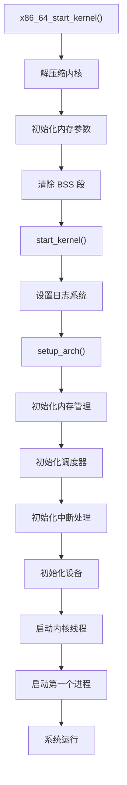

# vmlinuz C 代码部分（第一部分）：解压缩和初始化

## 概述

在汇编代码将 CPU 切换到长模式并设置好初始页表后，接下来进入 C 代码阶段。这部分包括：

1. **解压缩阶段**：vmlinuz 是压缩的内核，需要在内存中解压缩
2. **C 代码初始化**：调用 start_kernel() 进行正式的内核初始化
3. **内存管理初始化**：建立完整的页表和内存管理系统

## 1. 解压缩阶段（Decompression）

### 1.1 解压缩主程序入口

在 64 位长模式转换完成后，CPU 跳转到解压缩代码。关键源代码：

**源文件**：`kernel-7.0.0/arch/x86/boot/compressed/misc.c:1-100`

```c
// arch/x86/boot/compressed/misc.c (Linux 7.0.0)
// 这是解压缩主程序，处理 gzip、bzip2、xz 等压缩格式

asmlinkage __visible void *extract_kernel(void *rmode, 
                                          memptr heap,
                                          unsigned char *input_data, 
                                          unsigned long input_len,
                                          unsigned char *output, 
                                          unsigned long output_len)
{
    // rmode: 实模式参数块指针
    // heap: 堆的起始地址
    // input_data: 压缩内核数据起始地址
    // input_len: 压缩内核数据长度
    // output: 解压缩输出地址
    // output_len: 输出缓冲区大小
    
    // 1. 初始化 boot_params 结构
    boot_params = rmode;
    
    // 2. 初始化堆和栈
    mem_limit = check_mem_size();
    free_mem_ptr = heap;
    free_mem_end_ptr = heap + BOOT_HEAP_SIZE;
    
    // 3. 检查 CPU 功能（SSE、AVX 等）
    if (boot_params->hdr.loadflags & LOADED_HIGH) {
        // 内核被加载到高地址
    }
    
    // 4. 调用解压缩函数
    output = decompress(input_data, input_len, output, output_len);
    
    // 5. 获取命令行参数
    parse_elf(output);
    
    return output;  // 返回解压缩后的内核入口地址
}
```

### 1.2 支持的压缩格式

**源文件**：`kernel-7.0.0/arch/x86/boot/compressed/`

Linux 内核支持多种压缩格式，通过条件编译选择：

```c
// arch/x86/boot/compressed/misc.c
// 根据编译配置使用不同的解压函数

#ifdef CONFIG_KERNEL_GZIP
#include "misc.c"  // gzip 解压
#endif

#ifdef CONFIG_KERNEL_BZIP2
#include "bzip2/decompress.c"  // bzip2 解压
#endif

#ifdef CONFIG_KERNEL_LZMA
#include "xz/xz_private.h"  // LZMA 解压
#endif

#ifdef CONFIG_KERNEL_XZ
#include "xz/xz_private.h"  // XZ 解压
#endif

#ifdef CONFIG_KERNEL_LZO
#include "lzo/lzo1x_decompress_safe.c"  // LZO 解压
#endif

#ifdef CONFIG_KERNEL_ZSTD
#include "zstd/decompress.c"  // Zstandard 解压
#endif
```

**常用压缩格式对比**：

| 格式 | 压缩率 | 解压速度 | 文件大小 | 注意事项 |
|------|--------|---------|---------|---------|
| gzip | 中等 | 快 | 中等 | 最兼容 |
| bzip2 | 高 | 中等 | 较小 | 解压较慢 |
| xz | 最高 | 较慢 | 最小 | LZMA2 算法 |
| lzo | 低 | 最快 | 较大 | 嵌入式常用 |
| zstd | 中高 | 快 | 中等 | 新型算法 |

### 1.3 解压缩函数实现

以 gzip 为例：

**源文件**：`kernel-7.0.0/lib/decompress_gzip.c:1-50`

```c
// lib/decompress_gzip.c - gzip 解压实现
// 这是一个独立的解压缩库，不依赖 libc

static int gunzip(unsigned char *buf, long len,
                  int (*fill)(void*, unsigned long),
                  int (*flush)(void*, unsigned long),
                  unsigned char *out_buf, long out_len,
                  long *pos)
{
    // buf: 压缩数据缓冲区
    // len: 压缩数据长度
    // fill: 填充回调函数（读取更多数据）
    // flush: 刷新回调函数（输出解压数据）
    // out_buf: 输出缓冲区
    // out_len: 输出缓冲区大小
    // pos: 当前位置指针
    
    // 1. 检查 gzip 文件头
    if (buf[0] != 0x1f || buf[1] != 0x8b) {
        return -1;  // 无效的 gzip 头
    }
    
    // 2. 读取 gzip 文件头信息
    int method = buf[2];  // 压缩方法（通常为 8：deflate）
    int flags = buf[3];   // 标志位
    
    // 3. 跳过可选的文件头信息
    *pos = 10;
    if (flags & FNAME)
        while (buf[(*pos)++]);  // 跳过文件名
    
    // 4. 调用 inflate 解压函数
    state = malloc(sizeof(*state));
    state->out_buf = out_buf;
    state->out_len = out_len;
    
    ret = inflate(buf, len, fill, flush, out_buf, pos, state);
    
    // 5. 检查 gzip 结尾（CRC-32）
    // ...
    
    free(state);
    return ret;
}
```

## 2. 刚进入 C 代码的设置

### 2.1 start_kernel() 之前的准备

在调用 start_kernel() 前，需要进行一些初步设置：

**源文件**：`kernel-7.0.0/arch/x86/kernel/head64.c:1-150`

```c
// arch/x86/kernel/head64.c - 64 位内核入口准备

asmlinkage __visible void x86_64_start_kernel(char *real_mode_data)
{
    // real_mode_data: 指向实模式参数块
    
    // 1. 获取引导参数
    boot_params = (struct boot_params *)real_mode_data;
    
    // 2. 初始化内存参数（NUMA、E820 等）
    // 这会解析 boot_params 中的内存信息
    setup_memory_map();
    
    // 3. 检查内存容量
    // E820 内存表提供可用内存信息
    for_each_e820_range(start, end, type) {
        if (type == E820_RAM) {
            max_pfn = max(max_pfn, end >> PAGE_SHIFT);
        }
    }
    
    // 4. 初始化 zone 和 node
    // 建立 NUMA node 和内存 zone 的关系
    setup_memmap_regions();
    
    // 5. 初始化页分配器（buddy system）
    setup_free_pages();
    
    // 6. 检查命令行参数
    parse_early_param();
    
    // 7. 初始化控制台输出
    console_loglevel = early_console_loglevel;
    
    // 8. 清除内核 BSS 段（未初始化的全局变量）
    __bss_start = &__bss_start;
    __bss_stop = &__bss_stop;
    memset(__bss_start, 0, __bss_stop - __bss_start);
    
    // 9. 调用 start_kernel() - 正式开始内核初始化
    start_kernel();
}
```

### 2.2 E820 内存表

E820 是 BIOS 提供的内存信息。格式如下：

**源文件**：`kernel-7.0.0/arch/x86/include/uapi/asm/bootparam.h:30-50`

```c
// bootparam.h - E820 内存表结构

#define E820_MAX_ENTRIES 128

struct e820_entry {
    __u64 addr;      // 内存块起始地址
    __u64 size;      // 内存块大小
    __u32 type;      // 内存类型
    __u32 reserved;  // 保留字段（BIOS 扩展）
};

#define E820_RAM       1   // 可用内存
#define E820_RESERVED  2   // 保留区域
#define E820_ACPI      3   // ACPI 表区域
#define E820_NVS       4   // 非易失性存储
#define E820_UNUSABLE  5   // 不可用内存

struct e820_table {
    __u32 nr_map;              // E820 条目数量
    struct e820_entry map[128]; // 最多 128 个条目
};
```

**示例 E820 表输出**：

```
系统启动时，可能看到如下 E820 信息：
BIOS-provided physical RAM map:
BIOS-e820: [mem 0x0000000000000000-0x000000000009dfff] usable
BIOS-e820: [mem 0x000000000009e000-0x000000000009ffff] reserved
BIOS-e820: [mem 0x00000000000e0000-0x00000000000fffff] reserved
BIOS-e820: [mem 0x0000000000100000-0x00000000dffeffff] usable
BIOS-e820: [mem 0x00000000fffffc00-0x00000000ffffffff] reserved
BIOS-e820: [mem 0x0000000100000000-0x000000013fffffff] usable
```

## 3. start_kernel() 函数详解

这是内核 C 代码的入口点，完成大部分初始化工作。

**源文件**：`kernel-7.0.0/init/main.c:800-1100`

```c
// init/main.c - start_kernel() 是内核初始化的核心

asmlinkage __visible void __init start_kernel(void)
{
    // ========== 第一阶段：基础初始化 ==========
    
    // 1. 设置程序计数器位置
    set_task_stack_end_magic(&init_task);
    
    // 2. 禁用硬件中断
    local_irq_disable();
    
    // 3. 初始化 CPU 本地数据
    boot_cpu_init();
    
    // 4. 初始化内核日志记录
    setup_log_buf(0);
    
    // 5. 初始化架构特定的代码（如 IDT、GDT）
    setup_arch(&command_line);
    
    // 6. 初始化内存管理子系统
    mm_init_cpus();
    setup_command_line(command_line);
    setup_nr_cpu_ids();
    setup_percpu_areas();  // 设置 per-CPU 变量
    
    // ========== 第二阶段：内存分配器初始化 ==========
    
    // 7. 初始化页分配器（buddy system）
    build_all_zonelists(NULL);
    page_alloc_init();
    
    // 8. 初始化 slab 分配器
    // slab 是高效的内存分配器，用于频繁分配小对象
    kmem_cache_init();
    
    // 9. 初始化内存保护（SLUB、KASAN 等）
    setup_slub_min_order();
    
    // ========== 第三阶段：数据结构初始化 ==========
    
    // 10. 初始化文件系统相关结构
    vfs_caches_init_early();
    
    // 11. 初始化内核哈希表
    sort_main_extable();      // 异常表
    trap_init();              // 异常处理
    mm_init();                // 内存管理
    
    // 12. 初始化调度器
    sched_init();
    
    // 13. 初始化互斥锁、信号量等同步原语
    mutex_init(&mutex_lock);
    
    // ========== 第四阶段：设备和驱动初始化 ==========
    
    // 14. 初始化中断处理
    irq_init();
    init_IRQ();
    
    // 15. 初始化定时器
    tick_init();
    
    // 16. 初始化进程表和任务队列
    pidmap_init();
    anon_vma_init();
    
    // 17. 初始化安全相关模块
    security_init();
    
    // ========== 第五阶段：使用页缓存 ==========
    
    // 18. 初始化文件系统缓存
    vfs_caches_init(num_physpages);
    
    // ========== 第六阶段：启动第一个用户进程 ==========
    
    // 19. 启用硬件中断
    local_irq_enable();
    
    // 20. 进行 rest_init() 初始化（启动内核线程、init 进程等）
    rest_init();
    
    // 执行不会到此！rest_init() 会启动其他 CPU、创建内核线程等
    // 然后调用 schedule() 进行进程调度
}
```

### 3.1 setup_arch() - 架构特定初始化

**源文件**：`kernel-7.0.0/arch/x86/kernel/setup.c:800-1000`

```c
// arch/x86/kernel/setup.c - x86 架构特定的初始化

void __init setup_arch(char **cmdline_p)
{
    // 1. 获取处理器信息（CPUID）
    get_cpu_cap(&boot_cpu_data);
    
    // 2. 解析命令行参数
    parse_cmdline_early(cmdline_p);
    
    // 3. 初始化内存管理单元（MMU）
    // - 设置 E820 内存表
    // - 建立初始页表
    // - 启用内存保护
    e820__memory_setup();
    
    // 4. 初始化高级配置和电源接口（ACPI）
    // ACPI 提供电源管理、热插拔等功能
    // acpi_boot_init();  // 在之后的初始化中调用
    
    // 5. 检测并初始化 PCI 总线
    // pci_init_drivers();  // 在之后的初始化中调用
    
    // 6. 设置异常处理（IDT）
    // - 页故障（Page Fault）
    // - 保护故障（Protection Fault）
    // - 机器检查异常（Machine Check）
    // 等等
    trap_init();
    
    // 7. 初始化内存热插拔相关结构
    memory_hotplug_init();
    
    // 8. 建立内存节点和区域信息
    numa_init();
}
```

### 3.2 mm_init() - 内存管理初始化

**源文件**：`kernel-7.0.0/mm/page_alloc.c:6700-6800`

```c
// mm/page_alloc.c - 内存管理初始化

void __init mm_init(void)
{
    // 1. 初始化所有内存区域（zone）的伙伴分配器
    build_all_zonelists(NULL);
    
    // 2. 初始化页框分配器（page allocator）
    // 这是 Linux 内存管理的核心组件
    page_alloc_init_late();
    
    // 3. 初始化 slab/slub 分配器
    // 用于内核内存对象的快速分配
    kmem_cache_init_late();
    
    // 4. 初始化反向映射结构（rmap）
    // 用于跟踪哪些进程映射了哪些页
    anon_vma_init();
    
    // 5. 初始化文件系统缓存
    // - inode 缓存
    // - dentry 缓存（目录项）
    // - 页缓存
    vfs_caches_init_early();
}
```

## 4. 内核初始化序列（按优先级）



## 总结

vmlinuz C 代码部分是内核初始化的关键阶段：

1. **解压缩**：从 vmlinuz 中提取实际的内核代码和数据
2. **基础初始化**：设置内存管理、调度器等核心子系统
3. **设备初始化**：初始化硬件驱动和设备
4. **启动第一个进程**：创建 init 进程，完成内核启动

在下一部分中，我们将深入讨论 rest_init() 如何启动内核线程和第一个用户进程。
